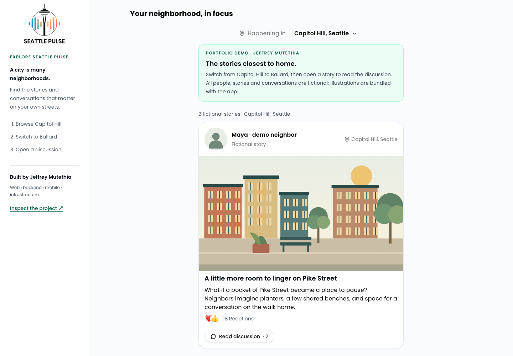

# Seattle Pulse

Citywide feeds bury the stories that matter a few blocks away. Seattle Pulse brings local content and neighborhood conversations together, so someone in Capitol Hill can discover a different slice of Seattle from someone in Ballard.

**[Try the live demo](https://seattle-pulse-demo.jeffreymutethia.chatgpt.site)** · [Engineering walkthrough](docs/ENGINEERING.md) · [Verification](docs/DEPLOYMENT.md#verified-release) · [CI](https://github.com/jeffreymutethia/Seattle-Pulse/actions/workflows/ci.yml)



Public demo capture, November 9, 2026. [Mobile feed](docs/screenshots/demo/mobile-feed.png) · [Desktop discussion](docs/screenshots/demo/desktop-discussion.png) · [Mobile discussion](docs/screenshots/demo/mobile-discussion.png)

Seattle Pulse is **Jeffrey Mutethia’s portfolio project**. He owned the project end to end across the **Next.js web app, Flask backend, Flutter mobile app, and infrastructure**.

## Explore the neighborhood

The demo opens directly to **Capitol Hill, Seattle**, with no account or setup. Choose **Ballard, Seattle** in the neighborhood selector to see a different set of stories, then open a story title or **Read discussion** to explore its seeded conversation.

All people, stories and conversations in the hosted walkthrough are clearly labeled fictional fixtures. The illustrations and fonts are bundled. The demo exercises guest feed browsing, neighborhood selection, story details and discussion rendering; it runs entirely in the browser without a backend or third-party keys. Accounts, persistent posting, ingestion, messaging, social ranking and the Flutter app are documented full-system paths.

## How it works

Publisher adapters ingest local headlines, source links, timestamps, descriptions and images into PostgreSQL through Flask/SQLAlchemy. The shared saver checks URLs and normalized or similar headlines for duplicates, associates each story with a publisher, and assigns a neighborhood from the publisher’s coverage area.

The combined feed applies neighborhood filtering before ordering. It queries matching stories newest-first, groups them by author or publisher, then interleaves one item from each group before pagination. A separate MyPulse following feed uses engagement with time decay. The [engineering walkthrough](docs/ENGINEERING.md) follows these paths through the code and explains their tradeoffs.

The hosted build supplies typed fixtures at [`postServices.ts`](frontend/app/services/postServices.ts) and [`contentService.ts`](frontend/app/services/contentService.ts), reusing the existing feed, location selector, story cards and comment components. The regular build keeps the API-backed behavior. [Architecture](docs/ARCHITECTURE.md) · [Deployment and test evidence](docs/DEPLOYMENT.md)

## Run locally

For the full stack, start Docker Desktop and run:

```sh
make demo
```

This builds Next.js and Flask, starts PostgreSQL and Redis, waits for the API, and seeds deterministic fictional posts. Open [localhost:3000](http://localhost:3000). The API is at [localhost:5050](http://localhost:5050); browser calls use that address, while server-side calls use Docker’s `backend:5000`.

Optional demo login: `demo@seattlepulse.local` / `DemoPass123!`. Run `make smoke` to check health, the guest feed, login and session persistence. `make seed` repairs existing demo neighborhood labels without duplicating posts. [Full local walkthrough and troubleshooting](docs/DEMO.md)

To run just the hosted walkthrough, use Node 20 or 22 and Python 3:

```sh
cd frontend
npm ci
npm run build:demo
npm run serve:demo
```

Open [localhost:3000](http://localhost:3000). Stop that server before running the browser check:

```sh
npm run test:demo
npm run typecheck
npm run build
```

The release-blocking browser test covers both desktop and mobile sizes, verifies that switching neighborhoods replaces the story set, opens the seeded discussion, and checks that resources stay on the demo’s origin. CI also builds the regular frontend and runs backend authentication, guest-feed and canonical-location regression tests. Repository-wide lint still has existing debt; see [verification details](docs/DEPLOYMENT.md#checks-and-limits).

## Inspect the implementation

- [`frontend/`](frontend/) — Next.js, React, TypeScript, Tailwind and Radix UI; static portfolio build in `frontend/demo/`.
- [`backend/`](backend/) — Flask API, SQLAlchemy, Celery, publisher adapters, Lambda and ECS definitions.
- [`mobile/`](mobile/) — Flutter client; optional for the web/API quickstart. See its [setup notes](mobile/README.md).
- [`docker-compose.yml`](docker-compose.yml) and [`Makefile`](Makefile) — full local stack, seeding and smoke checks.

Configure local values from [`.env.example`](.env.example), [`backend/.env.example`](backend/.env.example) and [`frontend/.env.example`](frontend/.env.example). See [SECURITY.md](SECURITY.md) for disclosure and secret-handling guidance.
