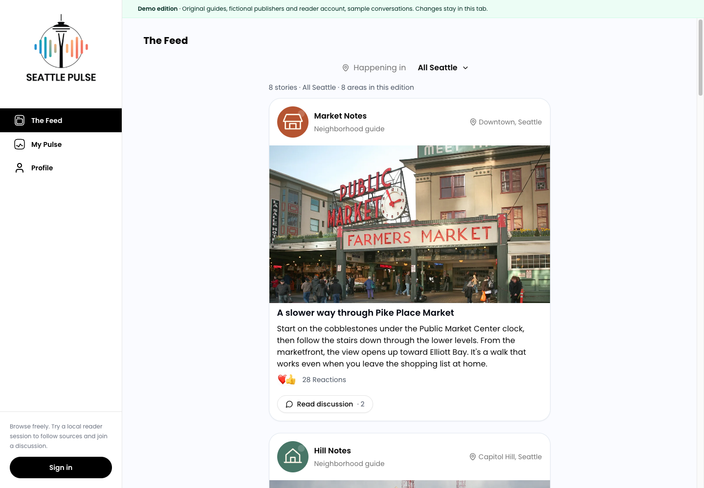

# Seattle Pulse

Local coverage is spread across citywide outlets and neighborhood blogs. Seattle Pulse brings those stories and neighborhood conversations into one feed: browse across Seattle, narrow the feed to an area, or follow sources to build a personal My Pulse feed.

The project includes a Next.js web app, Flask API, Flutter client, and deployment infrastructure. The public demo uses the web app's screens with eight original Seattle guides and browser-local interactions. The API-backed application and ingestion pipeline are available in the same repository.

**[Live demo](https://seattle-pulse-demo.jeffreymutethia.chatgpt.site/)** · [Engineering walkthrough](docs/ENGINEERING.md) · [Architecture](docs/ARCHITECTURE.md) · [CI](https://github.com/jeffreymutethia/Seattle-Pulse/actions/workflows/ci.yml)



Production capture, November 9, 2026. [Mobile feed](docs/screenshots/product/mobile-feed.png) · [Sign-in](docs/screenshots/product/desktop-sign-in.png) · [My Pulse](docs/screenshots/product/desktop-my-pulse.png) · [Profile](docs/screenshots/product/desktop-profile.png) · [Deployment and verification](docs/DEPLOYMENT.md)

## Explore the demo

1. Open **The Feed** in **All Seattle**. Filter to a neighborhood and open a story's sample discussion.
2. Choose **Sign in**, then **Continue as demo reader**. You return to the same neighborhood, with no password or account setup.
3. Open **My Pulse** to see guides from three followed sources. Follow or unfollow a source to change the feed, then explore **Profile**, its saved guides, local comments and editable bio.

The desktop sidebar and mobile navigation connect refreshable routes. Comments, follows and profile edits persist in the current browser tab's session storage.

The publishers, reader account, conversations and engagement are fictional. The guides describe real places, with bundled Seattle photography, credits and further-reading links. The static demo needs no backend or service credentials.

## How it works

Publisher adapters extract local headlines, links, timestamps, descriptions and images. A shared saver checks URLs and headline similarity for duplicates, associates each story with a publisher, and assigns a neighborhood from the publisher's coverage area. Flask, SQLAlchemy and PostgreSQL provide the API and persistence.

The combined feed filters by neighborhood, queries matching stories newest-first, then interleaves sources before pagination. The backend's separate My Pulse feed selects followed authors and orders by engagement with time decay.

The static build supplies typed fixtures at [`postServices.ts`](frontend/app/services/postServices.ts) and [`contentService.ts`](frontend/app/services/contentService.ts). It reuses the feed, location selector, cards, discussions, navigation and profile header; the demo sign-in adapts the original login screen. Its My Pulse filters fixtures by followed source without running the backend ranking. The [engineering walkthrough](docs/ENGINEERING.md) traces both paths.

## Run locally

For the full stack, start Docker Desktop and run:

```sh
make demo
```

This builds Next.js and Flask, starts PostgreSQL and Redis, waits for the API, and seeds deterministic fictional posts. Open [localhost:3000](http://localhost:3000). The API is at [localhost:5050](http://localhost:5050); browser calls use that address, while server-side calls use Docker's `backend:5000`.

Local login: `demo@seattlepulse.local` / `DemoPass123!`. Run `make smoke` to check health, the guest feed, login and session persistence. `make seed` repairs seeded neighborhood labels without duplicating posts. [Local setup and troubleshooting](docs/DEMO.md#full-local-system)

For the static product demo, use Node 20 or 22 and Python 3:

```sh
cd frontend
npm ci
npm run build:demo
npm run serve:demo
```

Open [localhost:3000](http://localhost:3000). Direct routes are `/`, `/auth/login/`, `/mypulse/` and `/profile/`. Stop the server before running the browser check:

```sh
npm run test:demo
npm run typecheck
npm run build
```

The blocking browser test covers the desktop and mobile journey, including neighborhood changes, sign-in, discussions, follows, profile edits, direct routes and reloads. It also checks image loading and the absence of backend or socket requests. CI builds the regular frontend and runs backend regression tests; repository-wide frontend lint remains advisory. See the [verification runbook](docs/DEPLOYMENT.md).

## Inspect the implementation

- [`frontend/`](frontend/) — Next.js, React, TypeScript, Tailwind and Radix; static routes in `frontend/demo/`, shared demo state and screens in `frontend/app/demo/`.
- [`backend/`](backend/) — Flask, SQLAlchemy, Celery, publisher adapters, Lambda and ECS definitions.
- [`mobile/`](mobile/) — Flutter client; optional for the Docker web/API quickstart. See its [setup notes](mobile/README.md).
- [`docker-compose.yml`](docker-compose.yml) and [`Makefile`](Makefile) — local stack, seeding and smoke checks.

Configure local values from [`.env.example`](.env.example), [`backend/.env.example`](backend/.env.example) and [`frontend/.env.example`](frontend/.env.example). See [SECURITY.md](SECURITY.md) for disclosure and secret handling.
