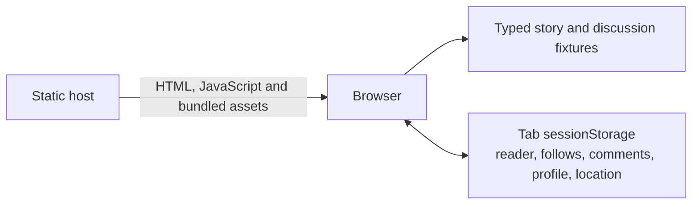
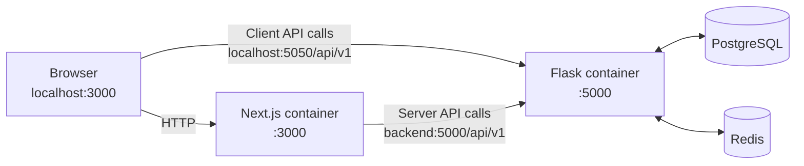
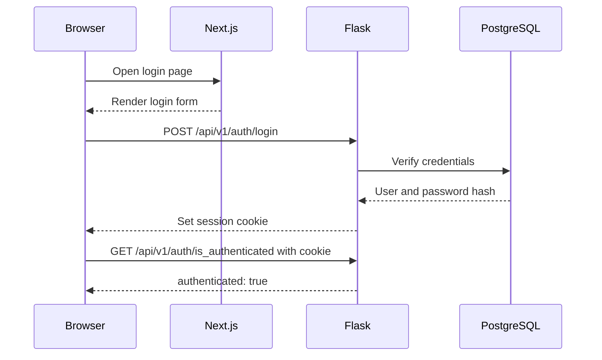

# Architecture

Seattle Pulse has two web builds: a static public demo and the API-backed
application. They share UI components and content types, with a build-time
flag selecting fixture services for the demo.

## Repository layout

| Path | Responsibility |
| --- | --- |
| [`frontend/`](../frontend/) | Next.js web app, API services and shared interface |
| [`frontend/demo/`](../frontend/demo/) | Static demo routes and export configuration |
| [`frontend/app/demo/`](../frontend/app/demo/) | Fixtures, browser-local session and demo screens |
| [`backend/`](../backend/) | Flask API, database models, publisher ingestion and deployment definitions |
| [`mobile/`](../mobile/) | Flutter client for the Flask API |
| [`docker-compose.yml`](../docker-compose.yml) | Local Next.js, Flask, PostgreSQL and Redis services |

## Static demo

`NEXT_PUBLIC_DEMO_MODE=true` enables the demo service boundary. The static
export contains `/`, `/auth/login/`, `/mypulse/` and `/profile/` as HTML entry
points. No Flask service, database or socket connection is required. Signing
in selects a fictional reader locally; it does not create a server session.

## Local API-backed application

`make demo` builds the services and seeds the database. Next.js renders the
interface, Flask handles authentication and content APIs, PostgreSQL stores
application data, and Redis supplies the configured Celery broker and result backend.
The root stack runs the backend web process; Celery worker and beat processes
have separate entrypoint commands and deployment definitions.

The two API base URLs serve different execution environments:

| Variable | Used by | Local value |
| --- | --- | --- |
| `NEXT_PUBLIC_API_BASE_URL` | Browser code | `http://localhost:5050/api/v1` |
| `INTERNAL_API_BASE_URL` | Next.js server code inside Docker | `http://backend:5000/api/v1` |

Host port `5050` maps to container port `5000`. The browser uses the host
address; only containers on the Compose network can resolve `backend`.

## Server login

This server-backed flow is separate from **Continue as demo reader** in the
static build.

## Ingestion and mobile

Publisher adapters parse source content into `UserContent` records. Shared
saving logic checks duplicates and attaches publisher coverage labels. The
combined feed filters those labels and interleaves sources; the My Pulse query
selects followed authors and applies engagement with time decay. See the
[engineering walkthrough](ENGINEERING.md) for the code paths and tradeoffs.

The Flutter app uses the Flask API independently of Next.js. It is optional for
the Docker quickstart and has its own API base URL configuration.

## Configuration and checks

Defaults are documented in [`.env.example`](../.env.example),
[`backend/.env.example`](../backend/.env.example) and
[`frontend/.env.example`](../frontend/.env.example). See
[SECURITY.md](../SECURITY.md) for secret handling.

[Local setup](DEMO.md) covers startup, seed maintenance and smoke checks.
[Deployment and verification](DEPLOYMENT.md) records hosting settings and the
scope of automated checks.
